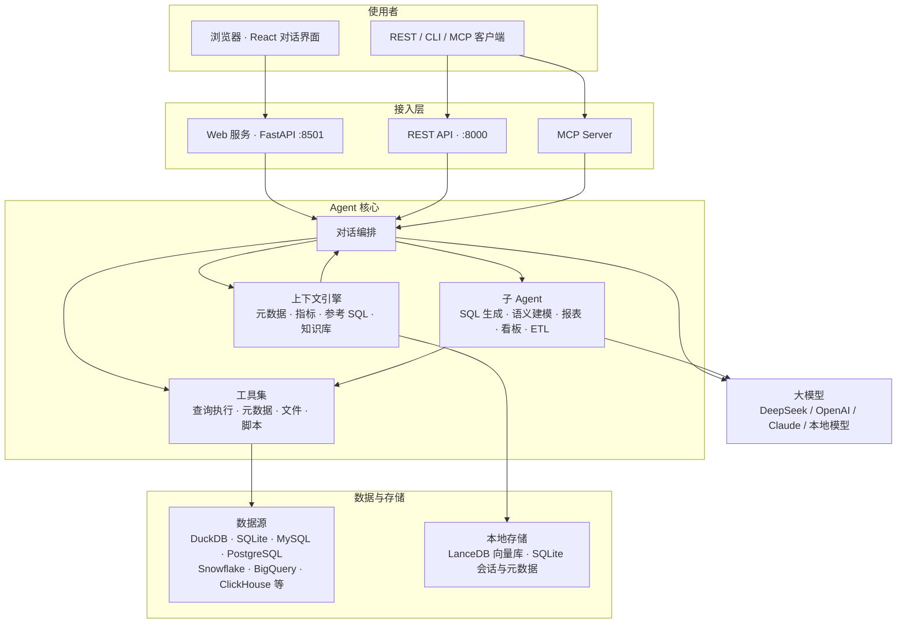

# Manager Agent

面向现代数据栈的**对话式数据工程 Agent**
把数据仓库、元数据、语义层与 BI 连接到一个可对话的智能体里。
打开浏览器即可用自然语言提问，Agent 会自己查元数据、写 SQL、执行并给出结论；
每一次追问与纠错都会沉淀为上下文，让后续回答越来越准。

## 架构

## 功能特性

**对话式分析**

- 自然语言直接问数，自动生成并执行 SQL，返回结果、解释与可视化
- 中英文提问与作答，SQL、表名、字段名保持原样
- 思考过程、工具调用、SQL 与结果实时流式展示
- 会话自动保存，可随时回看、续聊、分享链接

**数据接入**

- 支持 21 种数据源：DuckDB、SQLite、MySQL、PostgreSQL、Snowflake、BigQuery、
  ClickHouse、StarRocks、Doris、Trino、Hive、Oracle、Redshift、Athena 等
- 多数据源并存，运行时随时切换
- 内置示例库（DuckDB，17 张表）与 benchmark 数据集，装上即可体验

**上下文与语义**

- 上下文引擎自动收集表结构、参考 SQL、业务规则与知识库文档
- 自动生成语义模型与指标定义，无需手写 YAML
- 指标问答（AskMetrics）：基于指标口径直接作答，而不是临时拼 SQL
- 检索增强：业务域树 + 向量检索，本地嵌入模型，无需外网

**Agent 能力**

- 内置子 Agent：SQL 生成、语义建模、HTML 报表、交互式看板、ETL 与跨库迁移
- 支持自定义子 Agent，为单个业务域封装专属上下文、工具与规则
- 技能（Skills）与插件（Plugins）机制，按项目启用

**交付与集成**

- Web 对话界面（FastAPI + React），前端资源本地化，离线可用
- REST API（Swagger 文档）供应用调用
- 交互式 CLI：对话 / SQL / Bash 三种输入模式
- MCP Server，可接入 Claude Desktop、Cursor 等 MCP 客户端
- 生成的报表与看板为自包含 HTML，本地预览、无 SaaS 依赖

**治理**

- 分级权限配置，SQL 语句级授权与 AI 预审
- Bash 命令限制在沙箱内，敏感操作需确认
- 运行轨迹可导出到任意 OTLP 平台
- 模型、数据源、上下文全部本地持有，密钥不离开部署环境
